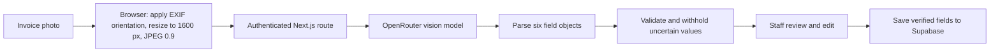

# OCR on the Add page

This guide describes the invoice reader powered by OpenRouter. It contains no
invoice photos or customer transcriptions. The test photos live in an ignored
local fixture directory and must not be committed without approval.

## Reader overview

The application uses an AI vision model via OpenRouter to read photographed
handwritten invoices. The browser downsizes and prepares the image, and sends it
through a secure server route to OpenRouter.

The Add form has six fields: Client Name, Phone Number, Date Received (`date`),
Date Promised, Instructions / Article Details, and Price. Article text is part
of the existing `instructions` field; there is no separate article database
column. The printed ticket number is not saved as a field.

## OpenRouter setup

1. Copy [`.env.example`](../../.env.example) to `.env.local` at the repository
   root. Set `OPENROUTER_API_KEY` there. `.env.local` is ignored by Git; do not
   use a `NEXT_PUBLIC_` prefix for this key.
2. Set `OPENROUTER_MODEL` (production uses `qwen/qwen3.8-omni-flash`). Restart the Next.js server after
   changing environment variables.
3. Run `npm run dev`. Open `/ocr-demo` for a local reader test without Supabase.
   The normal `/add` page requires a Supabase session. For a deployment, set
   the same server-only variables in the deployment environment.
4. Choose a photo on the Add page and click **Read invoice with AI**.
   This sends the resized photo to OpenRouter. Staff can cancel a read or enter
   values manually.

## Request and review flow

The browser first checks `GET /api/openrouter/read` for configuration and
model name. A read sends a JPEG data URL to `POST /api/openrouter/read`; the
server adds the API key and calls OpenRouter. The route checks same-origin
requests. Outside the local development demo, it requires a signed-in
Supabase user whose profile is not marked deleted. It limits the input size
and bounds the upstream call.
The key is never returned to the browser. The photo is not archived by this
flow; verified field values are saved only when staff submit the form.

The model is asked for each field as `{ value, evidence, confidence }`.
`evidence` should quote the writing and identify its form label or location.
The route rejects malformed or incomplete field objects. Separate model reasoning
is ignored. Model-provided evidence is a review aid, not independent verification.

The prompt covers the two known form layouts, handwriting crossing printed
labels, the store's footer phone, partial customer phone notation, callback
dates, durations in Date Promised, priced instruction lines, and corrected
totals. Staff must still compare every value with the photo.

## What can fill the form automatically

The shared validator in [`app/add/reader.ts`](../../app/add/reader.ts) applies
to model results:

Every value the model reads is pre-filled in the form for staff to check;
nothing is saved until staff tick that they checked it against the photo. The
validator decides what is pre-filled and what gets a "Check:" note (purple)
under the field:

| Field | Current rule |
| --- | --- |
| Client Name | Pre-filled; staff confirm handwriting and spelling. |
| Phone Number | Pre-filled. Flagged unless it has 7 or 10 digits, or the older one-digit area code form ("9) 890-2734"). The printed store phone is never filled. A plausible but wrong digit can pass these checks, so staff still compare it with the photo. |
| Date Received | Filled only as a valid calendar date; otherwise left blank with a note showing what was read. Callback notes are not this field. |
| Date Promised | Free text, kept as written ("2-3 weeks", "10 days ish"). A plain date is stored as a date. A box that is only a duration, or a month/day with no year, also gets a due date worked out from Date Received; the form says how it will be saved. |
| Instructions / Article Details | Pre-filled; staff confirm all lines, prices, and abbreviations. |
| Price | One amount ("125", "125.00", "125.-", "1,234.50"). Flagged when the evidence does not mention the total. Item prices, deposit, and balance are not totals. |

The model also reports whether each field's box is written, blank, or
unreadable. Blank fields are pre-ticked N/A; unreadable ones are left empty
with a note. Low-confidence readings, missing or mismatched evidence, and
values that fail the checks above get a "Check:" note with the reason and the
model's quote. Ticking N/A or Invalid, or typing in a field, keeps that field
as staff set it if the photo is read again. A model failure does not block
manual entry.

Study pages (`/study/*`) use their own prompt and keep Date Promised as an
MM-DD-YY date, so collected study data stays comparable.

## Relevant files

- [`app/add/photo-reader.tsx`](../../app/add/photo-reader.tsx): reader UI, progress,
  cancellation, and photo review.
- [`app/add/openrouter.ts`](../../app/add/openrouter.ts): browser health check,
  image upload, and response handling.
- [`app/api/openrouter/read/route.ts`](../../app/api/openrouter/read/route.ts):
  server-only key use, auth, same-origin check, and OpenRouter request.
- [`app/add/reader.ts`](../../app/add/reader.ts): shared prompt, image preparation,
  field parsing, and validation.
- [`app/add/add-form.tsx`](../../app/add/add-form.tsx): suggestions, accepted
  values, and the save confirmation.
